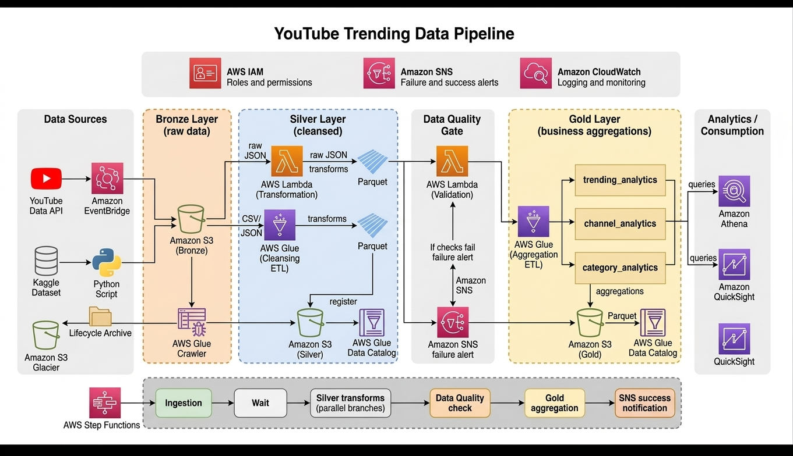
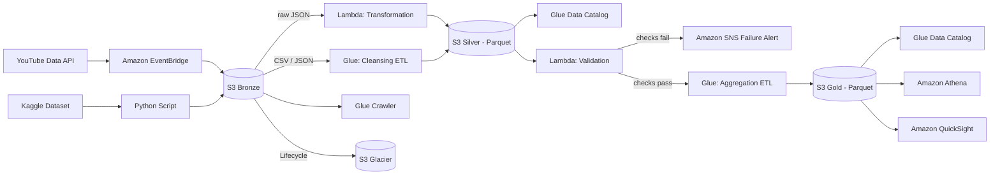

# YouTube Trending Data Pipeline on AWS

An end-to-end, serverless data pipeline on AWS that ingests YouTube trending data, cleans it, validates it, and turns it into analytics-ready tables for querying in Athena and dashboarding in QuickSight. It follows a **medallion architecture (Bronze → Silver → Gold)** and includes an automated **data quality gate** that stops bad data from reaching the dashboards.



---

## Table of Contents

1. [Project Overview](#project-overview)
2. [Architecture](#architecture)
3. [Tech Stack](#tech-stack)
4. [Data Sources](#data-sources)
5. [Pipeline Walkthrough](#pipeline-walkthrough)
6. [Data Quality Gate](#data-quality-gate)
7. [Gold Layer Tables](#gold-layer-tables)
8. [Monitoring, Alerting and Security](#monitoring-alerting-and-security)
9. [Cost Optimisation](#cost-optimisation)
10. [Analytics and Consumption](#analytics-and-consumption)
11. [Project Structure](#project-structure)
12. [How to Deploy](#how-to-deploy)
13. [Key Learnings](#key-learnings)
14. [Future Improvements](#future-improvements)
15. [Author](#author)

---

## Project Overview

Raw API and CSV data is rarely ready for analysis. This project builds a production-style pipeline that:

- Pulls trending video data from the **YouTube Data API** on a schedule, and loads a historical **Kaggle dataset** alongside it
- Stores everything untouched in a **Bronze** layer, so the raw data can always be reprocessed
- Cleans and converts the data to **Parquet** in a **Silver** layer
- **Validates** the Silver data before it moves on, and sends an alert if any check fails
- Builds **Gold** business-level aggregation tables that are ready for analytics
- Makes the results queryable with **Athena** and visual with **QuickSight**

## Architecture



Supporting services across the whole pipeline: **IAM** (roles and permissions), **SNS** (failure and success alerts), **CloudWatch** (logging and monitoring).

## Tech Stack

| Area | Tools |
|---|---|
| Ingestion | YouTube Data API, Amazon EventBridge, Python |
| Storage | Amazon S3 (Bronze, Silver, Gold), S3 Glacier |
| Processing | AWS Lambda, AWS Glue (ETL jobs and Crawler) |
| Metadata | AWS Glue Data Catalog |
| File format | JSON, CSV (raw), Apache Parquet (processed) |
| Data quality and alerts | AWS Lambda (validation), Amazon SNS |
| Analytics | Amazon Athena, Amazon QuickSight |
| Security and monitoring | AWS IAM, Amazon CloudWatch |
| Language | Python, SQL |

## Data Sources

1. **YouTube Data API** - trending video data, requested on a schedule through EventBridge. Arrives as raw JSON.
2. **Kaggle YouTube trending dataset** - historical data loaded with a Python script. Arrives as CSV / JSON.

Both sources land in the Bronze S3 bucket in their original form.

## Pipeline Walkthrough

### 1. Ingestion (Bronze layer)
- EventBridge triggers the ingestion of YouTube API data on a schedule.
- A Python script loads the Kaggle dataset.
- All data is stored **as-is** in the Bronze S3 bucket, so it can be replayed or reprocessed at any time.
- An **AWS Glue Crawler** scans the Bronze bucket to discover the schema.
- A **lifecycle policy** archives older raw files to **S3 Glacier** to reduce storage cost.

### 2. Cleansing and transformation (Silver layer)
There are two parallel transformation paths, depending on the source format:

- **Raw JSON (API data):** an **AWS Lambda** function transforms the JSON and writes **Parquet** files.
- **CSV / JSON (Kaggle data):** an **AWS Glue Cleansing ETL job** cleans the data and writes **Parquet** files.

The cleansed Parquet files are stored in the Silver S3 bucket and registered in the **Glue Data Catalog**, so they can be queried with SQL.

### 3. Data quality gate
A validation **Lambda** function checks the Silver data before it is allowed to reach the Gold layer. See the [next section](#data-quality-gate) for details.

### 4. Business aggregations (Gold layer)
When validation passes, an **AWS Glue Aggregation ETL job** builds the Gold tables and writes them as Parquet to the Gold S3 bucket. They are registered in the Glue Data Catalog as well.

### 5. Consumption
Analysts query the Gold tables with **Athena** and build dashboards in **QuickSight**.

## Data Quality Gate

The gate sits **between Silver and Gold**. Its purpose is simple: **bad data should never reach a dashboard.**

- A validation Lambda runs checks on the cleansed Silver data.
- **If the checks fail**, an **SNS failure alert** is sent and the data does not continue to the Gold layer.
- **If the checks pass**, the Gold aggregation job runs.

> Checks implemented: *(list yours here, for example null checks on key columns, duplicate checks, schema checks, value range checks)*

## Gold Layer Tables

| Table | Purpose |
|---|---|
| `trending_analytics` | Analytics on trending videos |
| `channel_analytics` | Aggregations at the channel level |
| `category_analytics` | Aggregations at the video category level |

All three are stored as Parquet in the Gold bucket and are queryable from Athena and QuickSight.

## Monitoring, Alerting and Security

- **Amazon CloudWatch** - logs and monitors the Lambda functions and Glue jobs.
- **Amazon SNS** - sends alerts when validation fails.
- **AWS IAM** - separate roles and permissions so each service only has the access it needs.

## Cost Optimisation

- **Parquet** (columnar, compressed) in Silver and Gold reduces storage size and Athena scan costs.
- **S3 Glacier lifecycle archiving** moves old raw Bronze data to cheaper storage.
- **Serverless services** (Lambda, Glue, Athena) mean there are no idle servers to pay for.

## Analytics and Consumption

- **Amazon Athena** - run SQL directly on the Gold tables in S3.
- **Amazon QuickSight** - dashboards built on top of the Gold layer.

Example query:

```sql
-- Replace with your own real column names
SELECT *
FROM category_analytics
LIMIT 10;
```

## Project Structure

```
youtube-trending-data-pipeline/
├── architecture.jpg
├── ingestion/          # Python script / API ingestion code
├── lambda/
│   ├── transformation/ # Bronze JSON -> Silver Parquet
│   └── validation/     # Data quality checks
├── glue/
│   ├── cleansing_etl/  # Silver cleansing job
│   └── aggregation_etl/# Gold aggregation job
├── sql/                # Athena queries
└── README.md
```

> Update this tree to match your actual repository.

## How to Deploy

1. Create the S3 buckets: Bronze, Silver, Gold.
2. Create IAM roles for Lambda and Glue with least-privilege access to those buckets.
3. Store your YouTube API key securely (for example in AWS Secrets Manager or an environment variable) and never commit it to GitHub.
4. Deploy the ingestion Lambda and create the EventBridge schedule rule.
5. Create the Glue Crawler, Glue ETL jobs and Data Catalog databases.
6. Deploy the transformation and validation Lambda functions.
7. Create the SNS topic and subscribe your email.
8. Add the S3 Glacier lifecycle rule to the Bronze bucket.
9. Connect Athena and QuickSight to the Gold tables.

## Key Learnings

- Designing a **medallion architecture** with clear responsibilities for each layer.
- Why a **data quality gate** is worth building: failing early with an alert is better than silently building dashboards on bad data.
- Working with **Parquet** and the **Glue Data Catalog** to make S3 data queryable.
- Combining **Lambda** and **Glue** and knowing when to use each one.
- Setting up **monitoring, alerting and least-privilege IAM** for a data pipeline.

## Future Improvements

- Add an orchestration layer (such as AWS Step Functions or Apache Airflow) to chain the stages and handle retries.
- Add more data quality rules and a success notification at the end of each run.
- Infrastructure as Code (Terraform or CloudFormation) for repeatable deployment.
- Add CI/CD for the Lambda and Glue code.

## Author

**Abdullah Khan**
Computer Systems Engineering graduate | Data Engineering and Analytics

- Portfolio: [iabdullahkhan.me](https://iabdullahkhan.me)
- LinkedIn: [linkedin.com/in/abdullahkhan5939](https://www.linkedin.com/in/abdullahkhan5939/)
- GitHub: [github.com/Abdullah2139](https://github.com/Abdullah2139)
